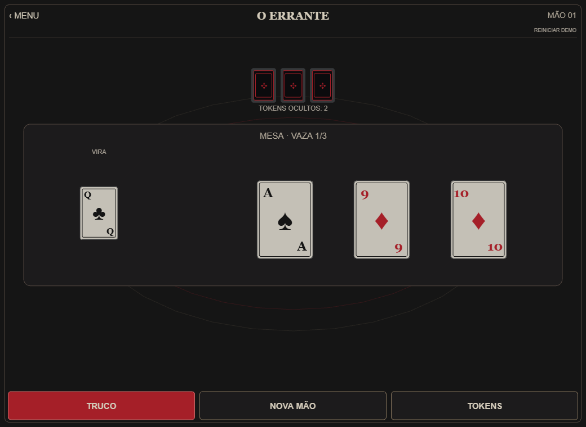
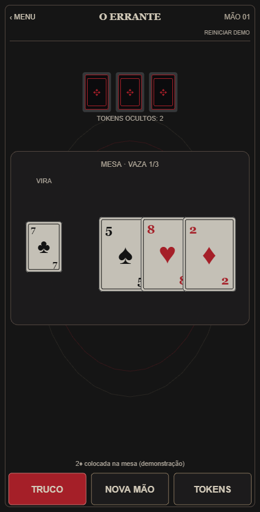
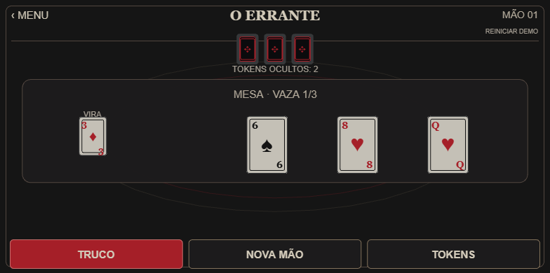

<h1 align="center">
  
</h1>

<p align="center">
  <strong>Um baralho amaldiçoado. Uma aposta além da vida.</strong>
</p>

<p align="center">
  <code>v0.2.0 · Em desenvolvimento</code><br />
  <code>JavaScript</code> <code>Phaser 4</code> <code>Vite 8</code>
</p>

**Last Whisper** é um jogo de cartas com proposta roguelite, inspirado no Truco e ambientado em fantasia sombria. Sobre uma mesa austera, entre cartas ocultas e adversários misteriosos, a visão é transformar cada mão em uma escolha de risco, blefe e sobrevivência.

**A versão atual é um protótipo interativo de interface e infraestrutura de cartas.** Já é possível distribuir e arrastar cartas; confrontos completos, apostas e expedições ainda fazem parte do planejamento.

[Sobre o jogo](#sobre-o-jogo) · [Estado atual](#estado-atual) · [Como executar](#como-executar) · [Controles](#controles) · [Roadmap](#roadmap) · [Capturas](#capturas-de-tela)

## Sobre o jogo

A familiaridade do Truco é o ponto de partida. Last Whisper pretende reinterpretar vira, manilhas e apostas em confrontos nos quais cartas específicas poderão receber encantamentos, recursos serão limitados e combinações de efeitos ajudarão a atravessar uma expedição.

O objetivo é construir estratégias ao longo da jornada: decidir quando arriscar, que cartas fortalecer e quais recursos guardar para o próximo adversário. A liberdade para novas regras faz parte da proposta; o projeto não busca reproduzir somente uma partida tradicional de Truco.

### Mecânicas e direção de jogo

| Elemento | Proposta e situação atual |
| --- | --- |
| **Baralho compartilhado** | Um monte de 52 cartas, sem Joker, serve aos dois jogadores e à vira. Geração, embaralhamento e distribuição já funcionam, sem reposição automática. As regras definitivas de reembaralhamento virão depois. |
| **Truco reinterpretado** | Vira, manilhas, turnos, três vazas e apostas formam a base planejada. A vira já é separada e exibida; cálculo de força, resolução de vazas e apostas ainda não existem. |
| **Encantamentos** | Sangue, Ferro, Ouro e Visão são conceitos planejados. A estrutura já permite guardar um encantamento por carta e substituí-lo explicitamente, mas não executa efeitos. |
| **Modificadores** | Cartas já podem armazenar modificadores identificados individualmente. Seu processamento e suas regras de duração serão implementados no futuro. |
| **Tokens e blefe** | Consumíveis estratégicos com identidade potencialmente oculta. A intenção é tornar perceptíveis sua quantidade e seu consumo, sem revelar necessariamente o efeito. Hoje, o contador e o botão são demonstrativos. |
| **Combate** | HP, escudo e dano associados aos resultados das mãos estão planejados. Não há combate funcional nesta versão. |
| **Progressão roguelite** | Expedições com adversários, recompensas, loja e construção de estratégias entre tentativas são parte da visão futura. |

Multiplayer é uma possibilidade futura, condicionada à validação da diversão do jogo.

### Os adversários

Cinco presenças orientam a direção artística planejada. São conceitos visuais, sem biografias ou habilidades definitivas.

| Adversário | Direção artística |
| --- | --- |
| **O Errante** | Um viajante de roupas gastas, marcado pelo baralho. |
| **A Viúva** | Uma figura elegante, envolta em véus e luto. |
| **O Carrasco** | Uma presença pesada, entre máscara e ferro oxidado. |
| **O Oráculo** | Uma figura misteriosa ligada a presságios. |
| **O Rei Sem Rosto** | A figura final, associada a uma coroa quebrada. |

O nome **O Errante** aparece no cabeçalho da demonstração atual. Isso ainda não representa um adversário com IA implementada.

## Estado atual

**v0.2.0 — Fundação visual e arquitetura de cartas.**

Implementado no código:

- Menu principal e navegação para a mesa de demonstração.
- Layout responsivo para desktop, portrait e landscape.
- Drag & Drop com mouse e toque, retorno animado após soltura inválida e bloqueio de cartas já jogadas.
- Posicionamento das jogadas dentro dos limites da mesa, preservado proporcionalmente após redimensionamento.
- Baralho compartilhado com 52 cartas únicas, IDs estáveis, definições imutáveis e embaralhamento Fisher–Yates.
- Distribuição de três cartas para cada jogador e uma vira; as outras 45 permanecem no monte inicial.
- Controle de zonas e propriedade das cartas, sem duplicação de jogadas.
- Estrutura serializável para encantamentos e modificadores, separada dos objetos Phaser.
- Testes automatizados de cartas, baralho e interação, além de um script de regressão em navegador.

**Ainda não implementado:** turnos, manilhas funcionais, resolução de vazas, pontuação, apostas, IA, efeitos de cartas, tokens funcionais, HP, dano, escudo, loja, expedições, áudio e multiplayer. Os rótulos de vaza e tokens na interface são demonstrativos.

### Como a demonstração usa o monte

**NOVA MÃO** mantém o mesmo baralho. As cartas da mão anterior, da mesa e a vira vão para o descarte, e outras sete são compradas. Identidades, encantamentos e modificadores são preservados. Se faltarem cartas, a mão atual permanece intacta e um aviso é exibido; não há reembaralhamento automático.

**REINICIAR DEMO** começa uma demonstração nova, com outras instâncias e metadados iniciais. Voltar ao menu e iniciar novamente tem o mesmo efeito. Essas operações do protótipo não definem as futuras regras de partida ou a duração dos encantamentos.

## Como executar

### Requisitos

- Node.js e npm. O Vite instalado declara suporte a Node `^20.19.0 || >=22.12.0`.
- Navegador para abrir o jogo.

O ambiente usado na validação da v0.2 tinha Node.js **26.13.0**. O teste opcional de navegador também usa a API nativa `WebSocket` do Node e foi validado nesse ambiente.

Com uma cópia do projeto aberta no terminal:

```bash
npm ci
npm run dev
```

Abra o endereço local informado pelo Vite no terminal.

### Testes e build

```bash
# Testes de lógica e dos handlers de interação
npm test

# Build de produção; arquivos gerados em dist/
npm run build

# Prévia local do build de produção
npm run preview
```

Na validação da v0.2, os **17 testes nativos** passaram, assim como o build de produção. O build emite um aviso de tamanho do bundle; isso não impede a compilação.

Para a regressão opcional com navegador:

```bash
npm run test:browser
```

O script inicia seu próprio servidor Vite e usa Edge em modo headless. O caminho padrão é o executável do Edge no Windows; para outro executável Chromium compatível, defina `BROWSER_PATH`. Ele cobre mouse, toque emulado em portrait/landscape, retornos, cliques repetidos, bloqueio de novas jogadas, resize, esgotamento do monte e navegação. Também atualiza as capturas em `artifacts/cards-v0.2/`.

A regressão passou nos três modos na validação da v0.2. Toque emulado não substitui a verificação em celulares físicos, que permanece pendente.

## Controles

| Ação | Como usar |
| --- | --- |
| Entrar na demonstração | Selecione **INICIAR PARTIDA** no menu. |
| Mover uma carta | Clique e arraste com o mouse, ou pressione e arraste com o dedo. |
| Colocar uma carta na mesa | Solte na região válida, à direita da vira. A carta permanece no ponto de soltura, limitada às bordas da área. |
| Cancelar uma soltura | Solte fora da região válida. A carta volta à mão e fica disponível ao terminar a animação. |
| Distribuir outra mão | Selecione **NOVA MÃO**, usando as cartas restantes do mesmo monte. |
| Começar outra demonstração | Selecione **REINICIAR DEMO**, no cabeçalho. |
| Voltar ao menu | Selecione **‹ MENU**. |

Cartas já jogadas ficam bloqueadas. **TRUCO** e **TOKENS** são botões demonstrativos e ainda não acionam mecânicas de partida.

## Capturas de tela

Capturas reais da demonstração v0.2, produzidas pelo script de regressão.

### Mesa no desktop



<details>
  <summary>Ver a mesa em portrait e landscape</summary>

<p align="center">
  
</p>



</details>

## Roadmap

Etapas organizadas a partir da visão do projeto e do estado da v0.2, sem datas de lançamento definidas.

| Fase | Escopo | Situação |
| --- | --- | --- |
| **1 · Fundação** | Phaser, estrutura do projeto, interface básica e responsividade. | Base implementada. |
| **2 · Truco básico** | Baralho, distribuição, vira, manilhas, turnos, vazas, apostas e IA. | Parcial: baralho, distribuição e vira disponíveis; regras e IA pendentes. |
| **3 · Combate** | HP, dano, escudo e condições de vitória. | Planejado. |
| **4 · Tokens e blefe** | Consumíveis, uso estratégico e informações ocultas. | Planejado; interface demonstrativa disponível. |
| **5 · Encantamentos e loja** | Efeitos nas cartas, economia e construção de estratégias. | Estrutura de dados disponível; efeitos e loja pendentes. |
| **6 · Roguelite** | Expedições, adversários, recompensas e progressão. | Planejado. |
| **7 · Polimento e publicação** | Arte final, efeitos, áudio, otimizações e lançamento web. | Planejado; direção visual inicial disponível. |

## Identidade visual

Fantasia sombria, ritualística e austera: uma mesa antiga, símbolos contidos e a sensação de que cada aposta tem consequências. A apresentação combina títulos clássicos, molduras discretas e acentos de sangue e bronze.

| Cor | Hexadecimal | Papel visual |
| --- | --- | --- |
| Obsidiana | `#151515` | Fundo e atmosfera. |
| Grafite | `#36383A` | Superfícies e cartas. |
| Sangue | `#A51F28` | Perigo, aposta e tensão. |
| Marfim | `#D2CAB9` | Tipografia e símbolos. |
| Bronze gasto | `#82715A` | Ornamentos e detalhes. |

Georgia orienta a tipografia dos títulos no jogo; Arial é usada nos textos de interface. No GitHub, a identidade aparece no banner SVG e nas capturas, enquanto o texto segue a tipografia nativa da plataforma. As cartas atuais são desenhadas programaticamente, sem ilustrações finais.

## Tecnologias e estrutura

| Tecnologia | Uso no projeto |
| --- | --- |
| **JavaScript com módulos ES** | Modelos de cartas, baralho e integração da demonstração. |
| **Phaser 4.2.1** | Cenas, renderização, entrada e animações. |
| **Vite 8** | Servidor de desenvolvimento e build de produção. |
| **HTML5 e CSS** | Página hospedeira, canvas e adaptação do espaço de jogo. |
| **Node.js e npm** | Ferramentas, scripts e testes com o runner nativo do Node. |

```text
src/
  game/
    cards/       # Definições, instâncias e dados de modificadores
    deck/        # Monte compartilhado e transições de zona
    DemoGame.js  # Distribuição e ciclo da demonstração
  logic/         # Estados de interação das cartas
  scenes/        # Menu principal e mesa de jogo
  theme/         # Paleta e tipografia
  ui/            # Componentes visuais e apresentação das cartas
tests/           # Testes de lógica e handlers
scripts/         # Regressão opcional no navegador
docs/            # Documentação técnica e assets do README
artifacts/       # Capturas reais da demonstração
```

A lógica das cartas e do baralho funciona sem importar Phaser. A definição original, a instância física, sua localização e sua apresentação têm responsabilidades separadas. Para os detalhes de identidade, zonas, metadados e APIs, consulte [Cartas e monte compartilhado — v0.2](docs/cards-v0.2.md).

## Contribuições e licença

O projeto está em uma etapa inicial. Ao relatar um problema, inclua os passos para reproduzi-lo, o navegador e, quando relevante, o tamanho da tela ou a orientação do dispositivo. Ao propor uma mudança, indique o objetivo e os testes realizados, mantendo clara a diferença entre infraestrutura e mecânicas ainda planejadas.

**Licença:** ainda não declarada no repositório.

---

<p align="center"><em>O baralho está sobre a mesa. O restante da jornada ainda está sendo escrito.</em></p>
