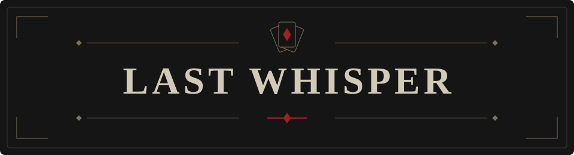
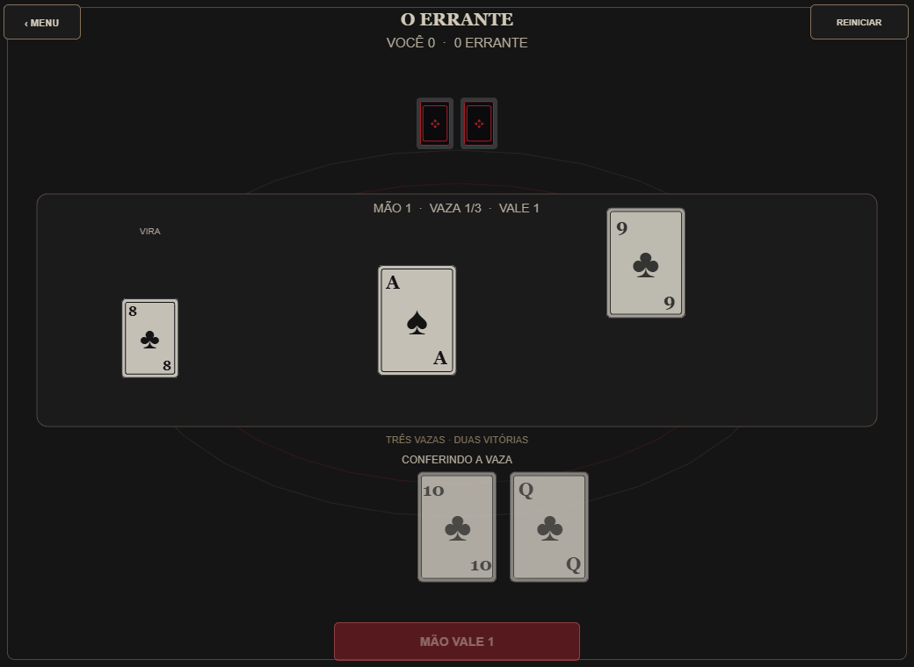
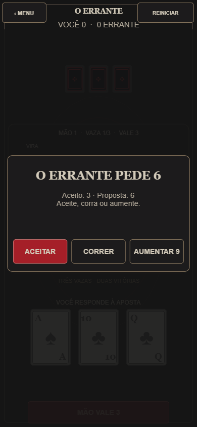
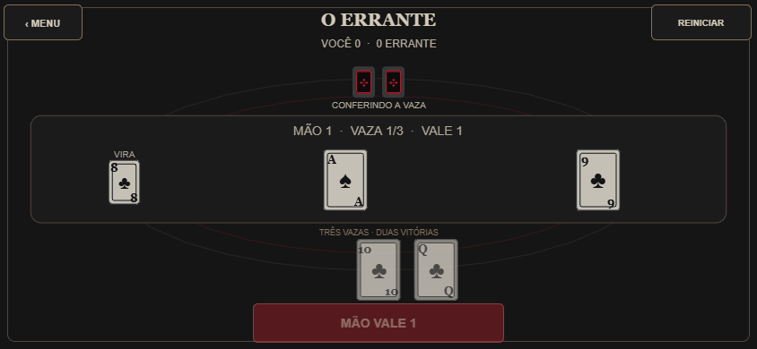

<h1 align="center">
  
</h1>

<p align="center">
  <strong>Um baralho amaldiçoado. Uma aposta além da vida.</strong>
</p>

<p align="center">
  <code>v0.3.0 · Integração jogável · Pacote 8/9</code><br />
  <code>JavaScript</code> <code>Phaser 4</code> <code>Vite 8</code>
</p>

**Last Whisper** é um jogo de cartas com proposta roguelite, inspirado no Truco e ambientado em fantasia sombria. Sobre uma mesa austera, entre cartas ocultas e adversários misteriosos, a visão é transformar cada mão em uma escolha de risco, blefe e sobrevivência.

**A versão atual permite disputar partidas completas de Truco contra uma IA intermediária.** Distribuição, manilhas, vazas, apostas, blefes, placar até 12 e próximas mãos estão integrados à mesa Phaser. A visão roguelite continua em planejamento.

[Sobre o jogo](#sobre-o-jogo) · [Estado atual](#estado-atual) · [Como executar](#como-executar) · [Controles](#controles) · [Roadmap](#roadmap) · [Capturas](#capturas-de-tela)

## Sobre o jogo

A familiaridade do Truco é o ponto de partida. Last Whisper pretende reinterpretar vira, manilhas e apostas em confrontos nos quais cartas específicas poderão receber encantamentos, recursos serão limitados e combinações de efeitos ajudarão a atravessar uma expedição.

O objetivo é construir estratégias ao longo da jornada: decidir quando arriscar, que cartas fortalecer e quais recursos guardar para o próximo adversário. A liberdade para novas regras faz parte da proposta; o projeto não busca reproduzir somente uma partida tradicional de Truco.

### Mecânicas e direção de jogo

| Elemento | Proposta e situação atual |
| --- | --- |
| **Baralho compartilhado** | Um monte de 52 cartas, sem Joker, serve aos dois jogadores e à vira. A distribuição é alternada. Quando necessário entre mãos, somente o descarte elegível volta a circular, preservando as instâncias. |
| **Truco reinterpretado** | Vira, manilhas, turnos, até três vazas e apostas `1 → 3 → 6 → 9 → 12` estão implementados. Naipes desempatam todos os valores; duas vitórias em vazas encerram a mão. |
| **Encantamentos** | Sangue, Ferro, Ouro e Visão são conceitos planejados. A estrutura já permite guardar um encantamento por carta e substituí-lo explicitamente, mas não executa efeitos. |
| **Modificadores** | Cartas já podem armazenar modificadores identificados individualmente. Seu processamento e suas regras de duração serão implementados no futuro. |
| **Tokens e blefe** | A IA já pode blefar nas apostas com probabilidade e limites configuráveis. Tokens consumíveis continuam planejados. |
| **Combate** | HP, escudo e dano associados aos resultados das mãos estão planejados. Não há combate funcional nesta versão. |
| **Progressão roguelite** | Expedições com adversários, recompensas, loja e construção de estratégias entre tentativas são parte da visão futura. |

Multiplayer é uma possibilidade futura, condicionada à validação da diversão do jogo.

### Os adversários

Cinco presenças orientam a direção artística planejada. São conceitos visuais, sem biografias ou habilidades definitivas.

| Adversário | Direção artística |
| --- | --- |
| **O Errante** | Um viajante de roupas gastas, marcado pelo baralho. |
| **A Viúva** | Uma figura elegante, envolta em véus e luto. |
| **O Carrasco** | Uma presença pesada, entre máscara e ferro oxidado. |
| **O Oráculo** | Uma figura misteriosa ligada a presságios. |
| **O Rei Sem Rosto** | A figura final, associada a uma coroa quebrada. |

**O Errante** identifica a IA intermediária da mesa atual. Estratégias, falas e animações específicas de personagens continuam como extensões futuras.

## Estado atual

**v0.3.0 — Truco jogável, integração do Pacote 8 de 9.**

Implementado no código:

- Menu principal e navegação para a mesa de demonstração.
- Layout responsivo para desktop, portrait e landscape.
- Drag & Drop com mouse e toque, retorno animado após soltura inválida e bloqueio de cartas já jogadas.
- Posicionamento das jogadas dentro dos limites da mesa, preservado proporcionalmente após redimensionamento.
- Baralho compartilhado com 52 cartas únicas, IDs estáveis, definições imutáveis e embaralhamento Fisher–Yates.
- Distribuição de três cartas para cada jogador e uma vira; as outras 45 permanecem no monte inicial.
- Controle de zonas e propriedade das cartas, sem duplicação de jogadas.
- Estrutura serializável para encantamentos e modificadores, separada dos objetos Phaser.
- Testes automatizados de cartas, baralho e interação, além de um script de regressão em navegador.
- Motor independente de Phaser para turnos, manilhas, vazas, apostas e pontuação.
- IA com observação restrita, decisões de cartas e apostas e blefes controlados.
- Resultados visíveis, transição automática entre mãos e telas de Vitória/Derrota.
- Modais de aposta, bloqueio de ações inválidas e cancelamento de tarefas antigas ao reiniciar ou sair.

**Ainda não implementado:** efeitos de cartas, tokens funcionais, HP, dano, escudo, loja, expedições, áudio, multiplayer e corte.

### Ciclo da partida

Cada mão começa valendo 1 ponto. O vencedor recebe o valor aceito; ao correr, o proponente recebe o último valor aceito. A partida termina aos 12 ou mais pontos, sem regra especial de mão de 11. Depois da apresentação do resultado, a próxima mão começa automaticamente, alternando o primeiro jogador.

O baralho permanece compartilhado. Cartas da mão encerrada são descartadas; se faltarem cartas no monte, o descarte elegível é reembaralhado. IDs, encantamentos e modificadores permanecem intactos. **REINICIAR** ou **JOGAR NOVAMENTE** cria outra partida com instâncias novas.

## Como executar

### Requisitos

- Node.js e npm. O Vite instalado declara suporte a Node `^20.19.0 || >=22.12.0`.
- Navegador para abrir o jogo.

O ambiente usado na validação da v0.2 tinha Node.js **26.13.0**. O teste opcional de navegador também usa a API nativa `WebSocket` do Node e foi validado nesse ambiente.

Com uma cópia do projeto aberta no terminal:

```bash
npm ci
npm run dev
```

Abra o endereço local informado pelo Vite no terminal.

### Testes e build

```bash
# Testes de lógica e dos handlers de interação
npm test

# Build de produção; arquivos gerados em dist/
npm run build

# Prévia local do build de produção
npm run preview
```

Na validação do Pacote 8, os **81 testes nativos** passaram, assim como o build de produção. O build emite o aviso existente de tamanho do bundle.

Para a regressão opcional com navegador:

```bash
npm run test:browser
```

O script inicia seu próprio servidor Vite e usa Edge em modo headless. O caminho padrão é o executável do Edge no Windows; para outro Chromium compatível, defina `BROWSER_PATH`. Cobre mouse, toque emulado em portrait/landscape, arrastos, rotação, apostas, transições, telas finais, reinício e menu. As capturas atuais ficam em `artifacts/truco-v0.3/`.

A regressão passou nos três modos na validação da v0.2. Toque emulado não substitui a verificação em celulares físicos, que permanece pendente.

## Controles

| Ação | Como usar |
| --- | --- |
| Iniciar uma partida | Selecione **INICIAR PARTIDA** no menu. |
| Mover uma carta | Clique e arraste com o mouse, ou pressione e arraste com o dedo. |
| Colocar uma carta na mesa | No seu turno, solte na região indicada à direita da vira. A carta fica limitada às bordas dessa área. |
| Cancelar uma soltura | Solte fora da região válida. A carta volta à mão e fica disponível ao terminar a animação. |
| Pedir aumento | Selecione **TRUCO** ou **PEDIR** quando o botão estiver habilitado. |
| Responder à aposta | Escolha **ACEITAR**, **CORRER** ou **AUMENTAR**, quando disponível. |
| Próxima mão | Aguarde a apresentação do resultado; a distribuição é automática. |
| Reiniciar | Selecione **REINICIAR** no cabeçalho ou **JOGAR NOVAMENTE** na tela final. |
| Voltar ao menu | Selecione **‹ MENU**. |

Cartas ficam bloqueadas fora do seu turno, durante propostas pendentes, animações e resultados. Ao terminar a partida, use Jogar novamente ou Menu.

## Capturas de tela

Capturas reais da integração Phaser, produzidas pelo script de regressão. As capturas anteriores da v0.2 permanecem em `artifacts/cards-v0.2/`.

### Mesa no desktop



<details>
  <summary>Ver a mesa em portrait e landscape</summary>

<p align="center">
  
</p>



</details>

## Roadmap

Etapas organizadas a partir da visão do projeto e do estado da v0.2, sem datas de lançamento definidas.

| Fase | Escopo | Situação |
| --- | --- | --- |
| **1 · Fundação** | Phaser, estrutura do projeto, interface básica e responsividade. | Base implementada. |
| **2 · Truco básico** | Baralho, distribuição, vira, manilhas, turnos, vazas, apostas e IA. | Integrado à interface; Pacote 8/9 da v0.3.0. |
| **3 · Combate** | HP, dano, escudo e condições de vitória. | Planejado. |
| **4 · Tokens e blefe** | Consumíveis, uso estratégico e informações ocultas. | Planejado; interface demonstrativa disponível. |
| **5 · Encantamentos e loja** | Efeitos nas cartas, economia e construção de estratégias. | Estrutura de dados disponível; efeitos e loja pendentes. |
| **6 · Roguelite** | Expedições, adversários, recompensas e progressão. | Planejado. |
| **7 · Polimento e publicação** | Arte final, efeitos, áudio, otimizações e lançamento web. | Planejado; direção visual inicial disponível. |

## Identidade visual

Fantasia sombria, ritualística e austera: uma mesa antiga, símbolos contidos e a sensação de que cada aposta tem consequências. A apresentação combina títulos clássicos, molduras discretas e acentos de sangue e bronze.

| Cor | Hexadecimal | Papel visual |
| --- | --- | --- |
| Obsidiana | `#151515` | Fundo e atmosfera. |
| Grafite | `#36383A` | Superfícies e cartas. |
| Sangue | `#A51F28` | Perigo, aposta e tensão. |
| Marfim | `#D2CAB9` | Tipografia e símbolos. |
| Bronze gasto | `#82715A` | Ornamentos e detalhes. |

Georgia orienta a tipografia dos títulos no jogo; Arial é usada nos textos de interface. No GitHub, a identidade aparece no banner SVG e nas capturas, enquanto o texto segue a tipografia nativa da plataforma. As cartas atuais são desenhadas programaticamente, sem ilustrações finais.

## Tecnologias e estrutura

| Tecnologia | Uso no projeto |
| --- | --- |
| **JavaScript com módulos ES** | Modelos de cartas, baralho e integração da demonstração. |
| **Phaser 4.2.1** | Cenas, renderização, entrada e animações. |
| **Vite 8** | Servidor de desenvolvimento e build de produção. |
| **HTML5 e CSS** | Página hospedeira, canvas e adaptação do espaço de jogo. |
| **Node.js e npm** | Ferramentas, scripts e testes com o runner nativo do Node. |

```text
src/
  game/
    cards/       # Definições, instâncias e dados de modificadores
    deck/        # Monte compartilhado e transições de zona
    DemoGame.js  # Distribuição e ciclo da demonstração
  logic/         # Estados de interação das cartas
  scenes/        # Menu principal e mesa de jogo
  theme/         # Paleta e tipografia
  ui/            # Componentes visuais e apresentação das cartas
tests/           # Testes de lógica e handlers
scripts/         # Regressão opcional no navegador
docs/            # Documentação técnica e assets do README
artifacts/       # Capturas reais da demonstração
```

A lógica das cartas e do baralho funciona sem importar Phaser. A definição original, a instância física, sua localização e sua apresentação têm responsabilidades separadas. Para os detalhes de identidade, zonas, metadados e APIs, consulte [Cartas e monte compartilhado — v0.2](docs/cards-v0.2.md).

A divisão entre motor, coordenação visual, entrada e desenho está descrita em [Integração Phaser — Pacote 8](docs/phaser-integration-v0.3.md).

## Contribuições e licença

O projeto está em uma etapa inicial. Ao relatar um problema, inclua os passos para reproduzi-lo, o navegador e, quando relevante, o tamanho da tela ou a orientação do dispositivo. Ao propor uma mudança, indique o objetivo e os testes realizados, mantendo clara a diferença entre infraestrutura e mecânicas ainda planejadas.

**Licença:** ainda não declarada no repositório.

---

<p align="center"><em>O baralho está sobre a mesa. O restante da jornada ainda está sendo escrito.</em></p>
